<style>
.ccr-todo { color: #ac4142; font-weight: normal; }
/* header and BibTeX styled after adriankruse.github.io/VINO */
.ccr-header { text-align: center; margin-bottom: 2rem; }
.ccr-title { margin: 0; font-size: 2rem; font-weight: 700; line-height: 1.15; letter-spacing: -0.01em; color: #18181b; }
.ccr-subtitle { margin: .75rem 0 0; color: #52525b; }
.ccr-authors, .ccr-affiliations { display: flex; flex-wrap: wrap; justify-content: center; gap: 2px 20px; }
.ccr-authors { margin: 1.25rem 0 0; font-size: 18px; }
.ccr-authors a { color: #2563eb; }
.ccr-affiliations { margin: .5rem 0 0; font-size: 16px; color: #52525b; }
.ccr-links { display: flex; flex-wrap: wrap; justify-content: center; gap: 12px; margin-top: 1.75rem; }
.ccr-links a { display: flex; align-items: center; padding: 9px 18px; border: 1px solid #e4e4e7; border-radius: 8px; background: white; box-shadow: 0 1px 2px rgba(0,0,0,.05); color: #18181b; font-size: 15px; text-decoration: none; transition: border-color .2s ease, box-shadow .2s ease; }
.ccr-links a:hover { border-color: #a1a1aa; box-shadow: 0 2px 6px rgba(0,0,0,.08); text-decoration: none; }
.ccr-links a:first-child { border-color: #18181b; background: #18181b; color: white; }
.ccr-links a:first-child::before { filter: invert(1); }
/* not out yet (no href): muted, no hover; placed after :first-child so it wins */
.ccr-links a:not([href]), .ccr-links a:not([href]):hover { border-color: #e4e4e7; background: white; box-shadow: none; color: #a1a1aa; cursor: default; }
.ccr-links a:not([href])::before { filter: none; opacity: .4; }
.ccr-links a::before { content: ""; width: 16px; height: 16px; margin-right: 8px; background: no-repeat center / contain; }
.ccr-links .ccr-paper::before { background-image: url("data:image/svg+xml,%3Csvg xmlns='http://www.w3.org/2000/svg' viewBox='0 0 24 24' fill='none' stroke='%2318181b' stroke-width='2' stroke-linecap='round' stroke-linejoin='round'%3E%3Cpath d='M14 2H6a2 2 0 0 0-2 2v16a2 2 0 0 0 2 2h12a2 2 0 0 0 2-2V8z'/%3E%3Cpolyline points='14 2 14 8 20 8'/%3E%3Cline x1='8' y1='13' x2='16' y2='13'/%3E%3Cline x1='8' y1='17' x2='16' y2='17'/%3E%3C/svg%3E"); }
.ccr-links .ccr-dataset::before { background-image: url("data:image/svg+xml,%3Csvg xmlns='http://www.w3.org/2000/svg' viewBox='0 0 24 24' fill='none' stroke='%2318181b' stroke-width='2' stroke-linecap='round' stroke-linejoin='round'%3E%3Cpolygon points='12 2 2 7 12 12 22 7 12 2'/%3E%3Cpolyline points='2 17 12 22 22 17'/%3E%3Cpolyline points='2 12 12 17 22 12'/%3E%3C/svg%3E"); }
.ccr-links .ccr-code::before { background-image: url("data:image/svg+xml,%3Csvg xmlns='http://www.w3.org/2000/svg' viewBox='0 0 1024 1024' fill='%2318181b'%3E%3Cpath d='M512.008 12.642c-282.738 0-512.008 229.218-512.008 511.998 0 226.214 146.704 418.132 350.136 485.836 25.586 4.738 34.992-11.11 34.992-24.632 0-12.204-0.48-52.542-0.696-95.324-142.448 30.976-172.504-60.410-172.504-60.410-23.282-59.176-56.848-74.916-56.848-74.916-46.452-31.778 3.51-31.124 3.51-31.124 51.4 3.61 78.476 52.766 78.476 52.766 45.672 78.27 119.776 55.64 149.004 42.558 4.588-33.086 17.852-55.68 32.506-68.464-113.73-12.942-233.276-56.85-233.276-253.032 0-55.898 20.004-101.574 52.76-137.428-5.316-12.9-22.854-64.972 4.952-135.5 0 0 43.006-13.752 140.84 52.49 40.836-11.348 84.636-17.036 128.154-17.234 43.502 0.198 87.336 5.886 128.256 17.234 97.734-66.244 140.656-52.49 140.656-52.49 27.872 70.528 10.35 122.6 5.036 135.5 32.82 35.856 52.694 81.532 52.694 137.428 0 196.654-119.778 239.95-233.79 252.624 18.364 15.89 34.724 47.046 34.724 94.812 0 68.508-0.596 123.644-0.596 140.508 0 13.628 9.222 29.594 35.172 24.566 203.322-67.776 349.842-259.626 349.842-485.768 0-282.78-229.234-511.998-511.992-511.998z'/%3E%3C/svg%3E"); }
.ccr-links .ccr-videolink::before { background-image: url("data:image/svg+xml,%3Csvg xmlns='http://www.w3.org/2000/svg' viewBox='0 0 24 24' fill='none' stroke='%2318181b' stroke-width='2' stroke-linecap='round' stroke-linejoin='round'%3E%3Ccircle cx='12' cy='12' r='10'/%3E%3Cpolygon points='10 8 16 12 10 16 10 8'/%3E%3C/svg%3E"); }
.ccr-bibtex { position: relative; margin-bottom: 1rem; }
.ccr-bibtex pre { margin: 0; padding: 16px 18px; white-space: pre-wrap; overflow-wrap: anywhere; border: 1px solid #e4e4e7; border-radius: 8px; background: #fafafa; color: #18181b; }
.ccr-bibtex pre, .ccr-bibtex code { font: 13px/1.6 ui-monospace, SFMono-Regular, Menlo, Consolas, monospace; }
.ccr-bibtex code { padding: 0; background: none; color: inherit; }
.ccr-bibtex button { position: absolute; top: 8px; right: 8px; padding: 4px 10px; border: 1px solid #e4e4e7; border-radius: 6px; background: white; color: #71717a; font: inherit; font-size: 13px; cursor: pointer; }
.ccr-bibtex button:hover { color: #18181b; }
.ccr figure { margin: 0 0 1rem; }
.ccr figure img { width: 100%; height: auto; margin-bottom: .4rem; }
.ccr figcaption { font-size: .85rem; line-height: 1.4; color: #767676; }
/* grids may be wider than the 50rem text column so the images stay readable */
.ccr-wide { position: relative; left: 50%; transform: translateX(-50%); width: min(64rem, calc(100vw - 2rem)); }
.ccr-grid { display: grid; gap: 1rem; grid-template-columns: 1fr; }
@media (min-width: 40em) { .ccr-grid { grid-template-columns: repeat(2, 1fr); } }
@media (min-width: 64em) { .ccr-grid.ccr-3 { grid-template-columns: repeat(3, 1fr); } }
.ccr-video { position: relative; aspect-ratio: 16 / 9; margin-bottom: 1rem; background: #f9f9f9; border: 1px dashed #ccc; border-radius: 5px; display: flex; align-items: center; justify-content: center; text-align: center; }
.ccr-video iframe { position: absolute; inset: 0; width: 100%; height: 100%; border: 0; border-radius: 5px; }
.ccr-attrib { font-size: .75rem; color: #767676; }
</style>

<div class="ccr" markdown="1">

<!-- Links: add href="..." to a link and drop "(soon)" once it exists; links without href show muted. -->
<header class="ccr-header" markdown="0">
  <h1 class="ccr-title"><strong>CAMCityRoads</strong>: The Cambridge City Roads Dataset</h1>
  <p class="ccr-subtitle">From raw LiDAR sweeps to a textured, labelled and georeferenced model of a city's local streets, recorded with one low-cost scanner and no GNSS.</p>
  <p class="ccr-authors">
    <span><a href="/">Alwyn Mathew</a><sup>1</sup></span>
    <span class="ccr-todo">Co-authors (TO ADD)</span>
  </p>
  <p class="ccr-affiliations"><span><sup>1</sup>University of Cambridge</span></p>
  <div class="ccr-links">
    <a class="ccr-paper">Paper (soon)</a>
    <a class="ccr-dataset">Dataset (soon)</a>
    <a class="ccr-code">Code (soon)</a>
    <a class="ccr-videolink">Video (soon)</a>
  </div>
</header>

<figure>
  
</figure>

## Overview

Local highway authorities maintain most of the road network, yet there is little open data on which to test
automated inspection of local streets, and little evidence of which measurements a cheap survey can be trusted for.
CAMCityRoads is an open mobile-mapping dataset of Cambridge, UK, built to provide both.

It holds 14 drives (51.7 km, 22.9 km of distinct street, much of it driven more than once) with:

- the raw LiDAR, camera and IMU streams;
- LiDAR SLAM trajectories and point clouds;
- 72 textured street meshes and a city mesh joining every drive;
- 26-class labels on every photo and every LiDAR point the camera sees;
- road and street-asset indicators mapped across the city, each validated between independent drives.

<!-- When the YouTube link exists, replace the placeholder <p> below with:
<iframe src="https://www.youtube-nocookie.com/embed/VIDEO_ID" title="CAMCityRoads video" loading="lazy" allow="accelerometer; encrypted-media; gyroscope; picture-in-picture" allowfullscreen></iframe>
-->
<div class="ccr-video">
  <p class="ccr-todo">Video: TO ADD (YouTube link)</p>
</div>

## The rig

<figure>
  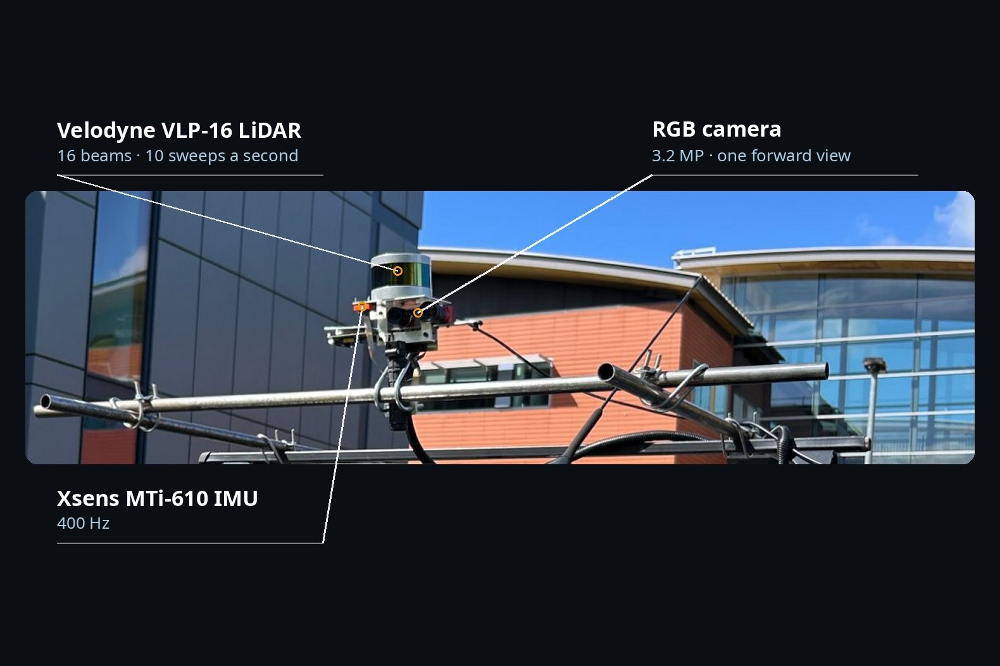
</figure>

A prototype scanner on the roof bars of a mid-sized van: a Velodyne VLP-16 LiDAR (16 beams, 10 sweeps a second), one
forward RGB camera (3.2 MP) and an Xsens MTi-610 IMU (400 Hz). There is no GNSS receiver; everything is positioned
from the LiDAR alone. None of the hardware is new: the LiDAR was eleven years old at the time of the survey.

## From raw data to a city model

<div class="ccr-wide ccr-grid ccr-3">
  <figure>
    <a href="/assets/camcityroads/04_lidar_sweep.jpg">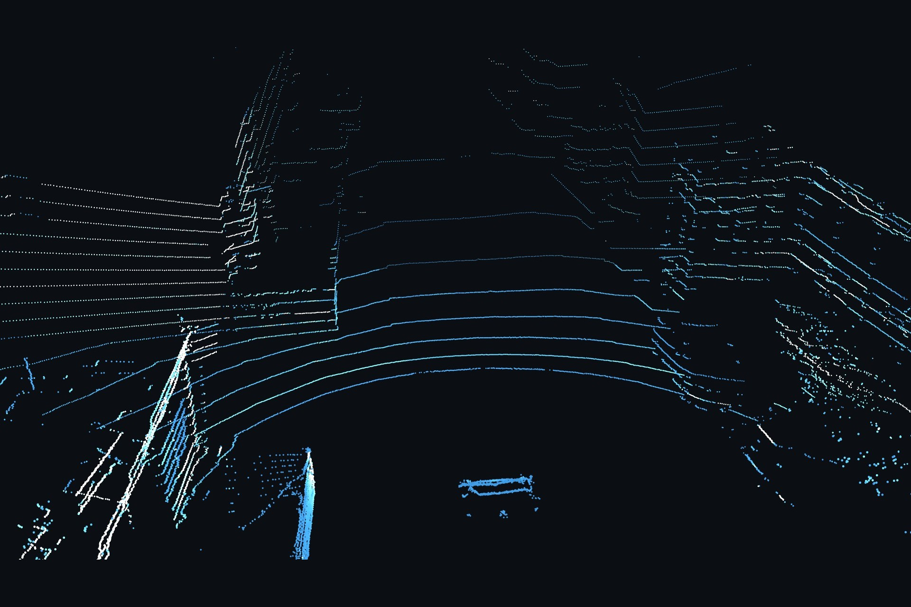</a>
    <figcaption><strong>One LiDAR sweep.</strong> A single 0.1 s rotation of the 16 beams.</figcaption>
  </figure>
  <figure>
    <a href="/assets/camcityroads/05_slam_map.jpg">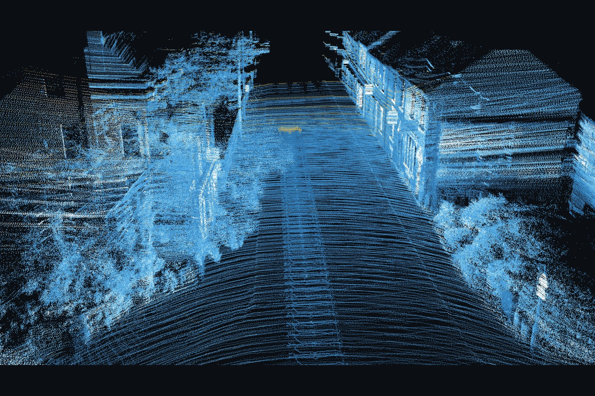</a>
    <figcaption><strong>SLAM map.</strong> Thousands of sweeps aligned into one loop-closed map.</figcaption>
  </figure>
  <figure>
    <a href="/assets/camcityroads/06_coloured_cloud.jpg">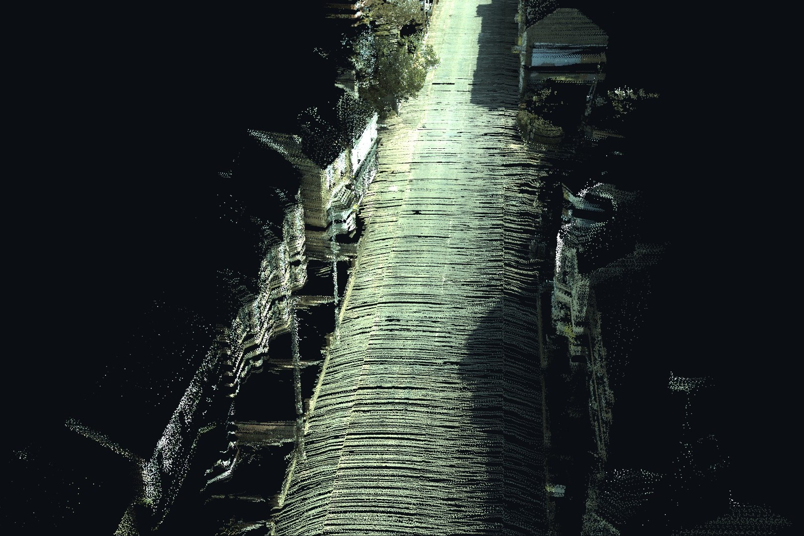</a>
    <figcaption><strong>Colour.</strong> Each point coloured from the anonymised photos.</figcaption>
  </figure>
  <figure>
    <a href="/assets/camcityroads/07_mesh_untextured.jpg">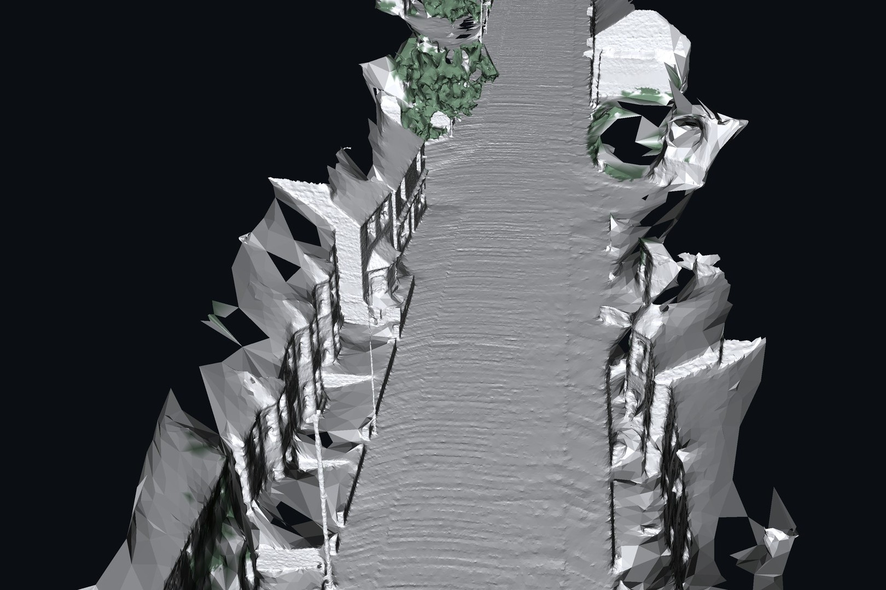</a>
    <figcaption><strong>Mesh.</strong> Surface geometry built from the LiDAR.</figcaption>
  </figure>
  <figure>
    <a href="/assets/camcityroads/08_mesh_textured.jpg">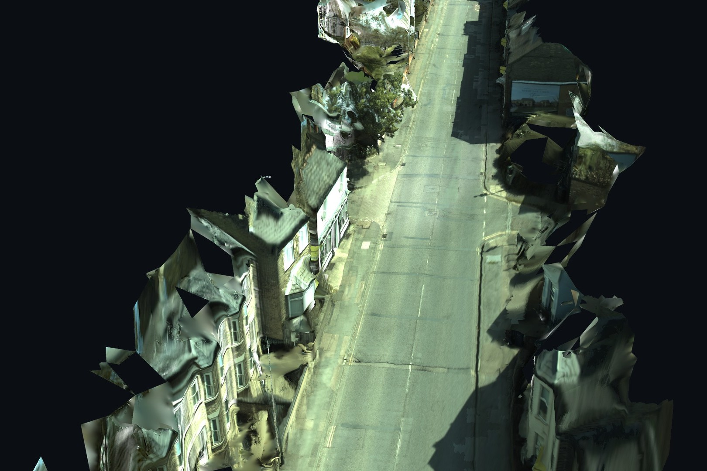</a>
    <figcaption><strong>Texture.</strong> The photos projected onto the LiDAR mesh.</figcaption>
  </figure>
  <figure>
    <a href="/assets/camcityroads/09_3d_labels.jpg">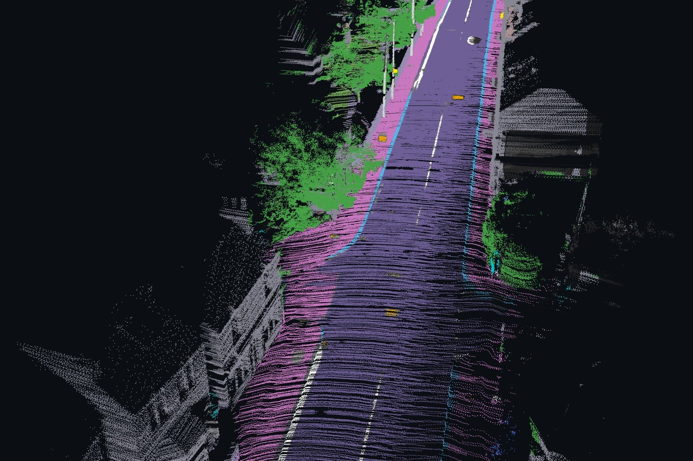</a>
    <figcaption><strong>3D labels.</strong> Road, footway, kerb, lane markings, manholes, buildings, vegetation, poles, street lights and traffic signs.</figcaption>
  </figure>
</div>

Faces and number plates are blurred in every photo, and the blurring is carried into the coloured clouds and the
mesh textures.

## Case studies

The labelled clouds and photos are used to map road and street-asset indicators every 10 m across the city. Each
map is checked by agreement between independent drives of the same street and by judging random samples of flagged
places in the photos.

<div class="ccr-wide ccr-grid ccr-3">
  <figure>
    <a href="/assets/camcityroads/10_usecase_road_markings.jpg">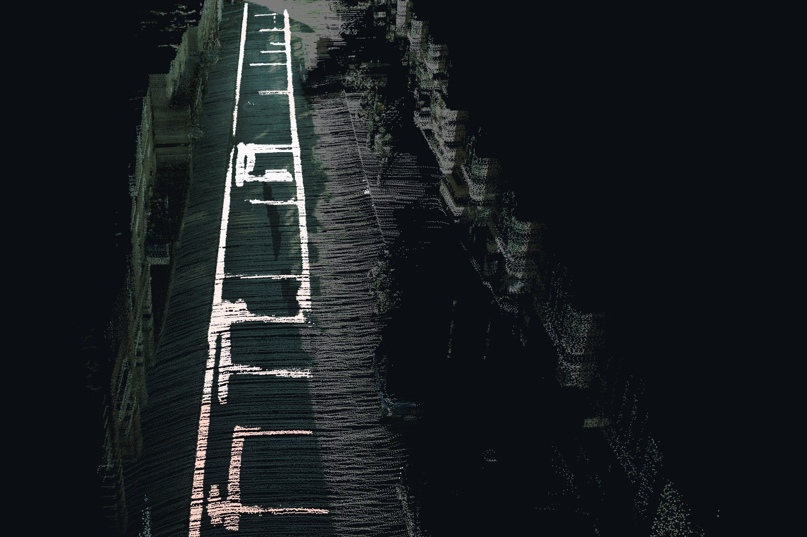</a>
    <figcaption><strong>Road markings.</strong> Painted markings, coloured by their contrast against fresh paint every 10 m (orange: lower, white: higher). An indicative measure of wear.</figcaption>
  </figure>
  <figure>
    <a href="/assets/camcityroads/11_usecase_vegetation.jpg">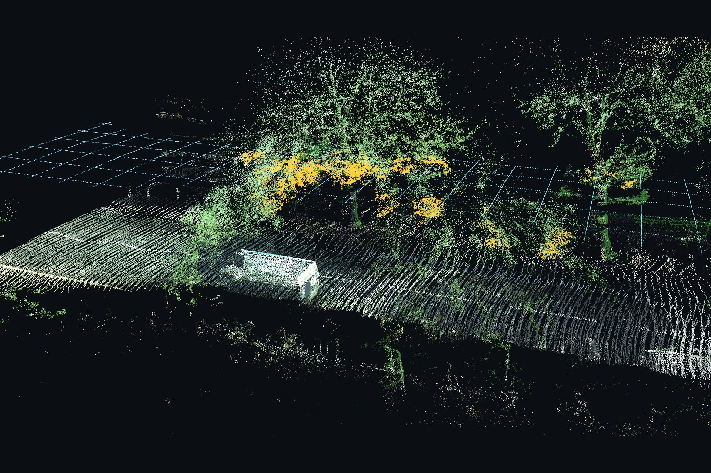</a>
    <figcaption><strong>Vegetation clearance.</strong> Branches inside the 5.3 m clearance over the carriageway (orange), under a grid drawn at 5.3 m above the road.</figcaption>
  </figure>
  <figure>
    <a href="/assets/camcityroads/12_usecase_traffic_sign_3d.jpg">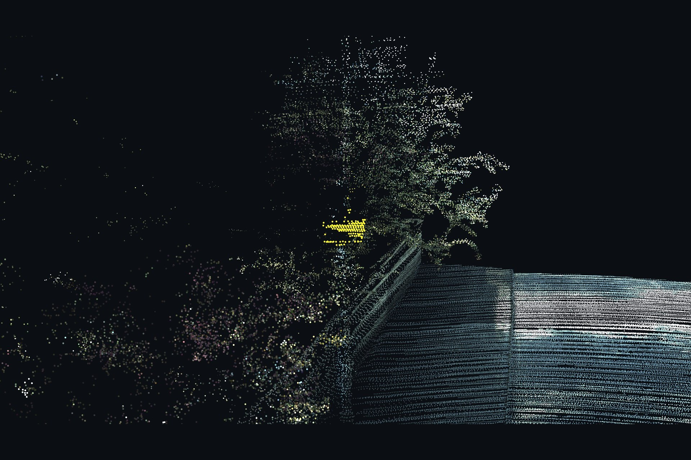</a>
    <figcaption><strong>Traffic signs hidden by foliage.</strong> A sign inside a tree (yellow in the point cloud). From 56 m away it cannot be seen; close up it is clear.</figcaption>
    <div class="ccr-grid" style="grid-template-columns: 1fr 1fr; gap: .5rem; margin-top: .5rem;">
      <a href="/assets/camcityroads/13_traffic_sign_photo_far.jpg">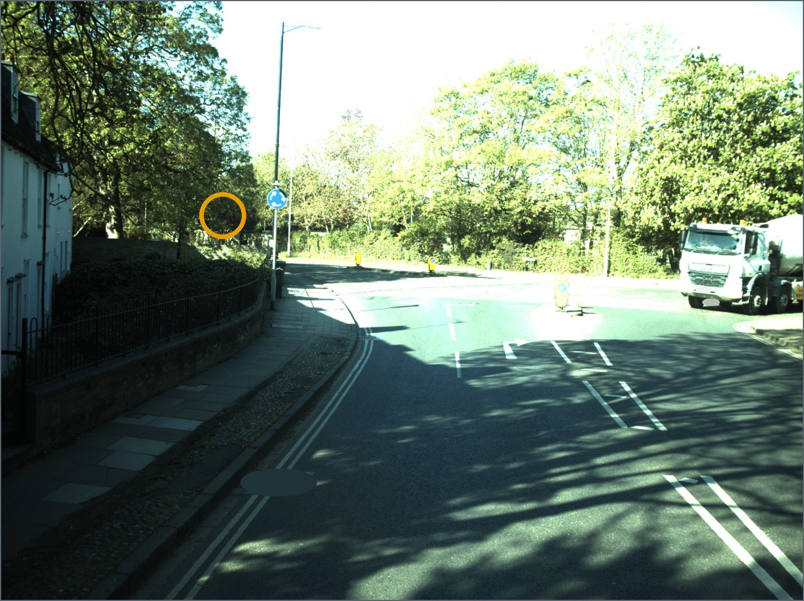</a>
      <a href="/assets/camcityroads/14_traffic_sign_photo_near.jpg">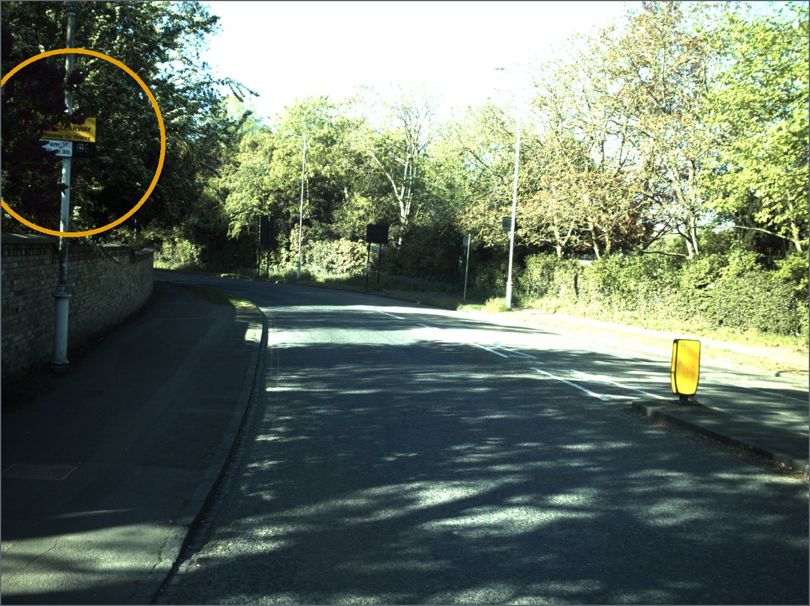</a>
    </div>
  </figure>
</div>

Between drives, gradient and crossfall agree to a median 0.14–0.15% and kerb height to 6 mm; 79–100% of judged
flagged places were confirmed. Rutting and ponding, millimetre-scale surface shape, do not repeat with this sensor
and are reported as limits.

## One city, on the national grid

<div class="ccr-wide">
  <div class="ccr-grid">
    <figure>
      <a href="/assets/camcityroads/15_city_drives.jpg">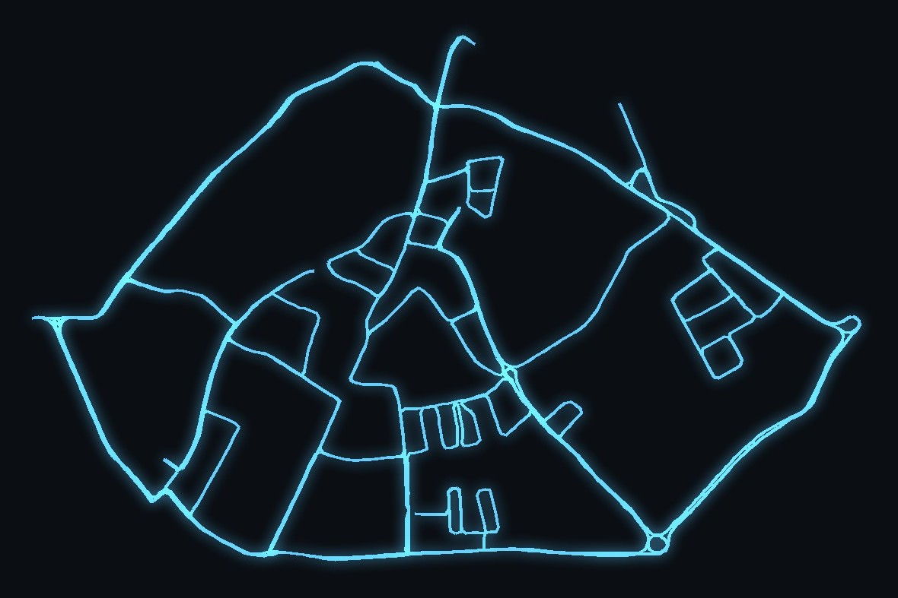</a>
      <figcaption>All 14 drives joined into one frame using the LiDAR alone.</figcaption>
    </figure>
    <figure>
      <a href="/assets/camcityroads/16_georeferenced_on_os_map.jpg">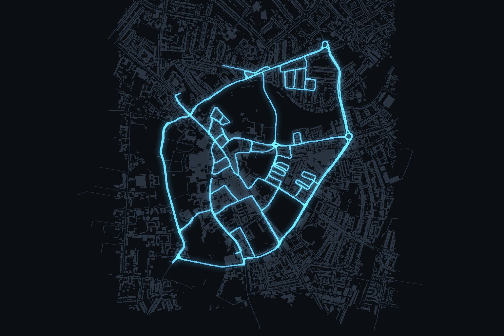</a>
      <figcaption>The same drives placed on the British National Grid using only open data (Ordnance Survey building outlines and the Environment Agency terrain model). On held-out sections the road lies a median 0.14 m from the terrain model and the facades 0.52 m from the building outlines.</figcaption>
    </figure>
  </div>
  <p class="ccr-attrib">Contains OS data © Crown copyright and database right 2026. Contains Environment Agency information © Environment Agency copyright and/or database right 2022.</p>
</div>

## Checking your download

Run these in the folder that holds the downloaded zips and `SHA256SUMS.txt`. Each one prints `<name>.zip: OK` when
the file is intact; on a failure, download that zip again.

**Linux**

```bash
# one zip
grep " raw.zip$" SHA256SUMS.txt | sha256sum -c

# all the zips you downloaded (skips the ones you didn't)
sha256sum -c --ignore-missing SHA256SUMS.txt
```

**macOS (Terminal)**

```bash
# one zip
grep " raw.zip$" SHA256SUMS.txt | shasum -a 256 -c

# all the zips you downloaded
for f in *.zip; do grep " $f$" SHA256SUMS.txt | shasum -a 256 -c; done
```

**Windows (PowerShell)**

```powershell
# one zip: prints the hash; compare it with the raw.zip line in SHA256SUMS.txt
Get-FileHash raw.zip -Algorithm SHA256

# all the zips you downloaded: prints OK or FAILED for each
Get-Content SHA256SUMS.txt | ForEach-Object { $h, $f = $_ -split '\s+', 2; if (Test-Path $f) { $ok = (Get-FileHash $f -Algorithm SHA256).Hash -eq $h; "${f}: $(if ($ok) {'OK'} else {'FAILED'})" } }
```

Replace `raw.zip` with any other zip name. Large zips take a few minutes each and show no progress.

## Citation

<div class="ccr-bibtex" markdown="0">
<button type="button">Copy</button>
<pre><code>@article{camcityroads,
  title   = {CAMCityRoads: The Cambridge City Roads Dataset},
  author  = {TO ADD},
  journal = {Advanced Engineering Informatics},
  year    = {TO ADD},
  doi     = {TO ADD}
}</code></pre>
</div>

<script>
  document.querySelector('.ccr-bibtex button').addEventListener('click', async (event) => {
    await navigator.clipboard.writeText(document.querySelector('.ccr-bibtex code').textContent);
    event.target.textContent = 'Copied';
    setTimeout(() => { event.target.textContent = 'Copy'; }, 1500);
  });
</script>

## Acknowledgements

Part of the Digital Roads Prosperity Partnership, supported by EPSRC [EP/V056441/1]. SLAM and LiDAR classification
were produced with Exwayz 3D Mapping, published with Exwayz's permission. The data are CC BY 4.0; the labels are
CC BY-NC-SA 4.0.

</div>
